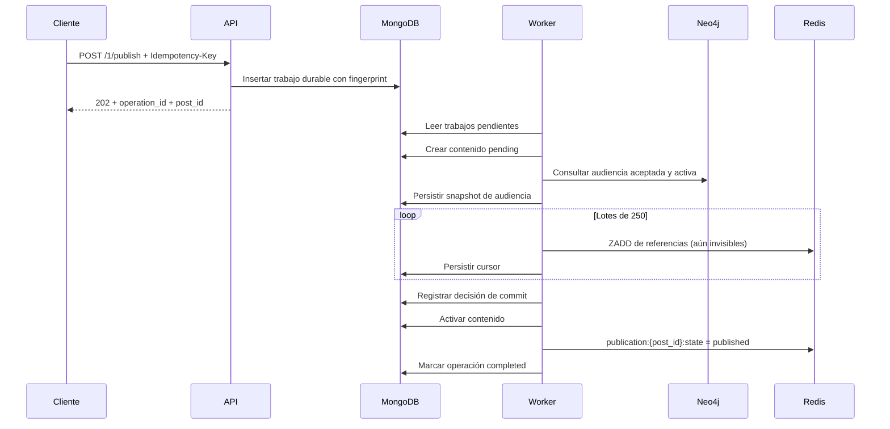

# Problema 1: publicación y distribución recuperable

## Qué está implementado

MongoDB guarda la publicación, el pedido durable, la audiencia y el avance.
Neo4j obtiene seguidores aceptados y activos, excluyendo bloqueos en ambos sentidos.
Redis conserva los sorted sets de feeds y la decisión compartida de visibilidad.

La API devuelve 202 con operation_id, post_id y status después de persistir el pedido,
sin consultar seguidores ni recorrerlos. El worker procesa lotes de 250 fuera del request.
Se admite una audiencia de hasta 100000 seguidores para mantener el snapshot por debajo
del límite documental de MongoDB; un exceso se compensa sin distribuir.
La carga global de 50000 registros del TP sigue pendiente; no se confunde con esta prueba.

## Secuencia y visibilidad



Los candidatos se escriben primero, pero solo son visibles cuando el marcador común Redis
dice published. El helper de lectura RedisPublicationFeeds.visible_ids aplica esa regla
en una sola ejecución Redis. MongoPostRepository.get también oculta contenido pending.
No se debe leer ZRANGE crudo como si ya fuera un feed público: incluye referencias en preparación.
El futuro P3 debe reutilizar esta regla, además de resolver ranking, paginación y contadores.
El endpoint /1/feed-preview/{user_id} solo demuestra los IDs visibles del P1; no resuelve P3.

La audiencia es un snapshot durable, no una consulta nueva en cada lote. Los cambios de
seguimiento durante la distribución pertenecen al P2 y deberán coordinarse con esa política.
Los nodos son User {id: UUID, account_status: active|suspended}, las aristas
FOLLOWS {status: accepted|pending} y BLOCKS. Ausencia de status equivale a accepted
y ausencia de account_status a active para compatibilidad con cargas pequeñas.

## Idempotencia y concurrencia

La clave se acota al autor. MongoDB garantiza unicidad del UUID determinista de operación
mediante _id. El fingerprint incluye autor, texto, media, intereses y visibilidad, sin UUID
ni fecha nuevos generados por cada request. Misma clave/contenido devuelve el mismo trabajo
y post; mismo identificador con contenido o escenario de falla distinto devuelve 409.
La clave queda retenida en MongoDB sin TTL. Sin clave, dos pedidos son dos publicaciones.

El procesamiento tiene un solo consumidor en el despliegue Compose. Un flock del sistema
sobre el volumen compartido publication_worker_lock evita consumidores superpuestos en ese
host, y el sistema operativo lo libera al terminar o morir el proceso. No se usa un lease
Redis que pueda expirar mientras un escritor todavía ejecuta. No es una coordinación
multi-host: ese despliegue requeriría otro mecanismo de ownership y fencing.

ZADD sobre el mismo UUID/score y la creación con setOnInsert son idempotentes. Un crash después
de escribir Redis y antes de guardar el cursor repite el lote sin duplicarlo.

## Fallas y compensación

Antes del commit, una falla guarda rollback=true y estado compensating. La recuperación:
1. Marca el post aborted en Redis, por lo que no aparece en lecturas de feed.
2. Ejecuta ZREM para toda la audiencia persistida, incluso el lote de resultado incierto.
3. Elimina el contenido MongoDB.
4. Marca la operación compensated.

Se elimina únicamente el UUID creado por ese pedido; no se borran otros posts ni feeds.
Abort, ZREM y delete_one se pueden repetir. Si falla la compensación, el trabajo conserva
rollback=true y el worker la reintenta. Si se cae el proceso, el siguiente arranque lee
los trabajos no terminales y retoma el cursor o la compensación.

La decisión de commit se persiste ANTES de activar la visibilidad. Después de esa decisión,
las fallas completan el commit mediante reintentos; no se revierte algo que otros ya pudieron
leer. El trabajo puede seguir running temporalmente aunque el marcador ya sea published.

Esto no recupera automáticamente pérdida de volúmenes ni todos los datos Redis ante pérdida
de su último segundo de AOF; se necesita reconstrucción desde MongoDB en ese escenario.
La garantía probada es recuperación de procesos con los volúmenes conservados.

## Ejecución y defensa

```bash
docker compose up -d --build
docker compose logs --tail 50 publication-worker
docker compose exec -T api python < scripts/validar_problema1.py
```

El script crea un autor y 2000 seguidores aislados, más seguidores pendientes, suspendidos
y bloqueados. Verifica entrega, exclusiones, intereses, replay concurrente, conflicto de
fingerprint y los cinco checkpoints. Deja los UUID impresos para inspección.
No es el generador global de datos del TP.

En Swagger, POST /api/v1/problems/1/publish:

```json
{
  "user_id": "UUID_DEL_AUTOR_IMPRESO",
  "text": "Publicación sobre ingeniería de datos",
  "interests": ["datos", "python"],
  "media": [],
  "visibility": "public"
}
```

Enviar Idempotency-Key (p. ej. publicar-demo-1). Consultar
GET /api/v1/problems/operations/{operation_id} hasta completed o compensated.
Consultar GET /api/v1/problems/1/feed-preview/{user_id} para comprobar visibilidad.

X-Fail-At-Step, solo en development, admite mongo_create_post, neo4j_load_followers,
redis_feed_update, redis_feed_partial y publication_commit.
redis_feed_partial falla DESPUÉS de escribir el primer lote y ANTES de guardar su cursor.
La respuesta inicial es 202: la falla y su compensación se observan en la operación.
Un replay de un pedido compensado devuelve la misma operación; para un nuevo intento de
negocio se usa una nueva clave. Los intereses no pueden estar vacíos.
Por ahora se admiten publicaciones públicas; reglas de cuentas privadas corresponden a P2.

Para demostrar recuperación tras interrupciones:

```bash
docker compose stop publication-worker
docker compose exec -T api python - --prepare < scripts/validar_recuperacion_p1.py
docker compose start publication-worker
docker compose exec -T api python - --verify < scripts/validar_recuperacion_p1.py
```

La preparación simula dos interrupciones con efectos reales: escritura de un lote antes
de guardar su cursor y compensación con Redis no disponible. El worker reiniciado completa
el primer pedido y revierte el segundo.

## Ubicación

- API: app/api/v1/routers/problems.py
- Encolado: PublishContentUseCase y MongoPublicationJobs
- Orquestación: PublicationProcessor
- Proceso consumidor: app/workers/publications.py
- Grafo: Neo4jSocialGraphRepository.follower_ids
- Feed/visibilidad: RedisPublicationFeeds
- Regresiones: tests/unit/test_publish_content.py

## Evidencia de esta implementación

- Suite pytest: 24 aprobadas, 1 integración placeholder omitida.
- Mypy: sin errores en aplicación y tests.
- Ruff: archivos modificados verificados y formateados.
- Motores reales: 2000 destinatarios, exclusión de pending/suspended/BLOCKS,
  replay concurrente, conflicto de fingerprint y cinco fallas con compensación.
- Reinicio real del worker: retomó un lote sin cursor guardado y una compensación
  interrumpida; los estados finales fueron completed y compensated respectivamente.
- Una ejecución local aceptó el pedido de 2000 seguidores en unos 19 ms. Es una
  observación de esa prueba, no un benchmark ni una garantía de latencia.
