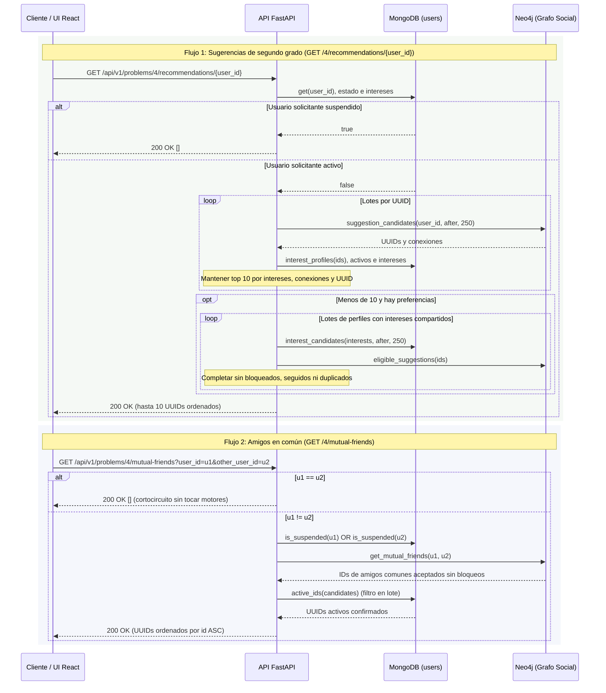

# Problema 04 — Amigos en común y sugerencias de cuentas

## Qué está implementado

Implementado combinando **Neo4j** como motor principal del grafo social (`FOLLOWS` y `BLOCKS`) y
**MongoDB** (`users`) como fuente de verdad del perfil, estado e intereses declarados.
Al tratarse de consultas de lectura sincrónicas (`GET`),
la API responde **200 OK** con la tupla ordenada de UUIDs sin encolar jobs ni requerir procesos
workers adicionales. Tampoco existe bypass de modo demo: ambos endpoints ejecutan siempre las
consultas reales sobre Neo4j y MongoDB.

El caso de uso `SocialRecommendationsUseCase` resuelve dos operaciones complementarias:

- **Amigos en común (`mutual_friends`):** obtiene todas las cuentas activas que son seguidas de
  forma aceptada simultáneamente por `user_id` y `other_user_id`, excluyendo bloqueos en cualquier
  dirección y cuentas suspendidas.
- **Sugerencias (`recommendations`):** hasta **10** cuentas. Primero segundo grado, ordenado
  por intereses comunes, luego contactos intermedios distintos y UUID ascendente. Si quedan
  lugares, completa con otras cuentas con intereses compartidos, ordenadas por intereses
  comunes y UUID, validando seguimientos/bloqueos en Neo4j. Sin preferencias declaradas
  mantiene el orden por contactos y UUID.

## Intereses del perfil y edición

`User.interests` vive únicamente en MongoDB: no se infiere de las etiquetas de posts ni se
duplica en Neo4j. Los usuarios antiguos sin el campo se leen con lista vacía; se conservan
UUID, relaciones y publicaciones. Registrar usuarios admite una lista opcional de intereses.

`PUT /api/v1/users/me/interests` recibe `{"interests":["Python","música"]}` con bearer.
Reemplaza atómicamente solo las preferencias del titular activo y devuelve el perfil guardado.
No acepta elegir otro usuario ni modificar otros campos. Repetir el contenido es idempotente;
no hay escritura multimotor, compensación ni worker adicional para guardar preferencias.

Se admiten hasta 20 etiquetas de 1 a 40 caracteres normalizados: NFKC, casefold, espacios
compactados y sin duplicados; los acentos se conservan. `[]` elimina preferencias; entradas
inválidas devuelven 422 y una credencial/cuenta no válida devuelve 401. La escritura vuelve
a comprobar el estado activo para no modificar preferencias tras una suspensión.

El índice multikey `ix_user_interests_status_id` sirve a la búsqueda por intereses/estado.
El orden por UUID puede requerir ordenamiento adicional: no se afirma que todo el ranking
esté cubierto por el índice. La integración verifica un plan con hint; el rendimiento debe
medirse con el dataset final.

Los candidatos se leen por lotes de 250 con cursor de UUID. Se examinan todos los lotes para
calcular el orden y se conservan solo los diez mejores en memoria. No se trunca a los primeros
30 del grafo antes de consultar intereses. El complemento se calcula después de agotar el
segundo grado elegible. Perfiles y filtros se consultan en lote, sin una consulta por candidato.
El costo crece con candidatos y páginas: no hay costo constante ni snapshot transaccional entre
motores; los cambios concurrentes pueden requerir refrescar para ver un resultado actualizado.

## Secuencia, consultas Cypher y validación cruzada



### 1. Consulta Cypher de amigos en común (`get_mutual_friends`)

```cypher
MATCH (u1:User {id:$u1})-[r1:FOLLOWS]->(f:User)
      <-[r2:FOLLOWS]-(u2:User {id:$u2})
WHERE f <> u1 AND f <> u2
  AND coalesce(r1.status,'accepted')='accepted'
  AND coalesce(r2.status,'accepted')='accepted'
  AND coalesce(u1.account_status,'active')='active'
  AND coalesce(u2.account_status,'active')='active'
  AND coalesce(f.account_status,'active')='active'
  AND NOT (u1)-[:BLOCKS]-(f)
  AND NOT (u2)-[:BLOCKS]-(f)
  AND NOT (u1)-[:BLOCKS]-(u2)
RETURN DISTINCT f.id AS id ORDER BY id
```

- Exige que ambas relaciones `FOLLOWS` estén aceptadas (`coalesce(r.status, 'accepted') = 'accepted'`),
  manteniendo compatibilidad con datos sembrados sin propiedad `status` y excluyendo solicitudes
  de seguimiento `pending` en cuentas privadas (P2).
- Si existe una arista `BLOCKS` en cualquier sentido entre `(u1, f)`, `(u2, f)` o entre los propios
  usuarios consultados `(u1, u2)`, el candidato (o toda la consulta entre ambos) queda excluido.
- `RETURN DISTINCT f.id AS id ORDER BY id` garantiza idempotencia de lectura y un orden lexicográfico
  determinista de UUIDs.

### 2. Consulta Cypher de candidatos de segundo grado (`suggestion_candidates`)

```cypher
MATCH (u:User {id:$id})-[r1:FOLLOWS]->(middle:User)
      -[r2:FOLLOWS]->(candidate:User)
WHERE candidate <> u
  AND ($after IS NULL OR candidate.id > $after)
  AND coalesce(r1.status,'accepted')='accepted'
  AND coalesce(r2.status,'accepted')='accepted'
  AND coalesce(u.account_status,'active')='active'
  AND coalesce(middle.account_status,'active')='active'
  AND coalesce(candidate.account_status,'active')='active'
  AND NOT (u)-[:FOLLOWS]->(candidate)
  AND NOT (u)-[:BLOCKS]-(middle)
  AND NOT (middle)-[:BLOCKS]-(candidate)
  AND NOT (u)-[:BLOCKS]-(candidate)
RETURN candidate.id AS id, count(DISTINCT middle) AS score
ORDER BY id LIMIT $limit
```

- Recorre caminos de longitud 2 sobre seguimientos aceptados `u -> middle -> candidate`.
- Descarta auto-sugerencias (`candidate <> u`), cuentas a las que `u` ya sigue o ya solicitó seguir
  (`NOT (u)-[:FOLLOWS]->(candidate)`, cubriendo tanto `accepted` como `pending`), y cualquier camino
  donde exista un bloqueo entre `u` y `middle`, entre `middle` y `candidate`, o entre `u` y `candidate`.
- Devuelve `count(DISTINCT middle)` y pagina por UUID; la aplicación combina este valor
  con intereses comunes de MongoDB para calcular el orden final.

## Determinismo, concurrencia y coordinación con P2 y P8

| Escenario | Garantía implementada |
|---|---|
| Consulta `mutual-friends` con `user_id == other_user_id` | Cortocircuito inmediato en `SocialRecommendationsUseCase` y en el repositorio; devuelve `()` sin consultar bases. |
| Grafo sin candidatos para el usuario | Si Neo4j devuelve `()`, no se realiza la consulta `$in` vacía a MongoDB. |
| Solicitud de seguimiento pendiente en cuenta privada (P2) | No genera amigos en común ni puentes de segundo grado, pero sí impide volver a sugerir esa cuenta a quien ya envió la solicitud (`NOT (u)-[:FOLLOWS]->(candidate)`). |
| Suspensión en curso o reciente (P8) | En P8 (`AccountProcessor`), MongoDB marca `account_status = 'suspended'` antes de actualizar Neo4j. La doble verificación (`is_suspended` para los extremos y `active_ids` por lote para los resultados) evita filtrar o recomendar cuentas recién suspendidas. |
| Candidatos recién suspendidos en MongoDB | Los perfiles por lote y la búsqueda por intereses excluyen suspendidos antes del ranking; se procesan lotes hasta agotar candidatos sin corte fijo de 30. |
| Intermediario (`middle`) suspendido o bloqueado | Excluido en Cypher (`coalesce(middle.account_status, 'active') = 'active'` y `NOT (u)-[:BLOCKS]-(middle)`): un nodo suspendido o bloqueado nunca actúa como puente de recomendación. |
| Dependencia caída (MongoDB o Neo4j no disponibles) | Propaga el error de infraestructura y devuelve **503 Service Unavailable**, sin simular respuestas vacías ni usar datos demo. |

Las consultas no requieren claves de idempotencia, bloqueos de escritura ni compensaciones.
La edición es una escritura atómica e idempotente de un documento MongoDB.

## API, prueba manual con Swagger y frontend

### Endpoints HTTP

1. **`GET /api/v1/problems/4/recommendations/{user_id}`**
   - Parámetro de ruta: `user_id` (UUID v4).
   - Respuesta `200 OK`: lista JSON de hasta 10 UUIDs de cuentas sugeridas ordenadas por relevancia.
2. **`GET /api/v1/problems/4/mutual-friends?user_id={u1}&other_user_id={u2}`**
   - Parámetros de query validados por `MutualFriendsRequest`: `user_id` (UUID) y `other_user_id` (UUID).
   - Respuesta `200 OK`: lista JSON de UUIDs de amigos en común ordenados por identificador.
3. **`PUT /api/v1/users/me/interests`**: edición autenticada de preferencias; también se
   devuelven intereses en `GET /users/me` y perfiles públicos.

### Paso a paso en Swagger (`http://localhost:8000/docs`)

1. Registrar usuarios en `POST /api/v1/users` e iniciar sesión en `POST /api/v1/users/login`.
2. Autorizar con el `access_token` en **Authorize** y crear seguimientos con `POST /api/v1/social/follows`,
   esperando a que `GET /api/v1/social/operations/{operation_id}` indique `completed`.
3. Ejecutar `GET /api/v1/problems/4/recommendations/{user_id}` con el UUID del usuario origen para
   obtener sugerencias de segundo grado.
4. Ejecutar `GET /api/v1/problems/4/mutual-friends` indicando `user_id` y `other_user_id` para
   verificar las cuentas seguidas en común.

### Pantalla en el frontend React (`/recomendaciones`)

La SPA incorpora el módulo `frontend/src/features/recommendations/` accesible desde la barra de
navegación lateral/inferior bajo **Sugerencias** (`/recomendaciones`, ruta protegida por sesión):

- **Mis intereses:** permite agregar/quitar etiquetas, guardar, vaciar preferencias y reintentar
  errores conservando la edición. Tras guardar refresca el perfil y las recomendaciones. Las
  tarjetas muestran intereses compartidos. La prueba E2E `recommendations.spec.ts` verifica
  ranking, complemento, recarga y borrado en escritorio y móvil usando la API real.
- **Sección Cuentas sugeridas:** consulta `GET /api/v1/problems/4/recommendations/{user.id}`,
  renderiza cada candidato mediante `UserCard` (que carga `GET /api/v1/users/{id}` con caché
  compartida de 5 minutos en TanStack Query y oculta cuentas no disponibles con `404`), permite
  refrescar sugerencias y ofrece el botón **"Ver amigos en común"** en cada tarjeta para cargar
  automáticamente ese UUID en el buscador inferior.
- **Sección Consultar amigos en común:** formulario con validación previa en cliente (impide vacío,
  impide consultar la propia cuenta y valida formato UUID con Zod `mutualFriendsQuerySchema` antes
  de emitir el request) y grilla de tarjetas con los perfiles resultantes.

### Usuarios, contraseñas y UUIDs de prueba en base de datos

Para las pruebas manuales en UI (`/login` y `/recomendaciones`) y en Swagger, se unificó la
contraseña de la cuenta personal y de todos los lotes de prueba `qa-p4-*` en **`123456789`**
(y `scripts/validar_problema4.py` usa `DEFAULT_PASSWORD = os.getenv("P4_PASSWORD", "123456789")`).

#### 1. Cuentas principales del entorno

| Username | Contraseña | User UUID (`_id`) | Email | Rol / Estado |
|---|---|---|---|---|
| `rosariobonata` | `123456789` | `aaf5a730-8863-444a-a551-bd8325bd308d` | `rosariobonata@gmail.com` | `user` / `active` |
| `lautaro1` .. `lautaro10` | `12345678` | `a8debe19-def9-5b85-870e-13848e1ef956` (`lautaro1`), `1fe58082-d620-5806-af2e-ada98385fafa` (`lautaro2`) | `lautaroN.11111111@followers.example.test` | `user` / `active` |

#### 2. Lote principal de validación Problema 4 con ranking de 2 candidatos (`qa-p4-832003b7-*`)

| Username | Contraseña | User UUID (`_id`) | Email | Rol en el grafo P4 |
|---|---|---|---|---|
| `qa-p4-832003b7-usera` | `123456789` | `b07b4b02-077a-4182-9cf2-b5b6b5a551b8` | `qa-p4-832003b7-usera@test.local` | Usuario solicitante (`usera`): sigue a `common` y a `userb` |
| `qa-p4-832003b7-userb` | `123456789` | `471c75b8-5060-40fe-9e15-2a2845b312bb` | `qa-p4-832003b7-userb@test.local` | Segundo usuario (`userb`): sigue a `common` y a `target` |
| `qa-p4-832003b7-common` | `123456789` | `fadf72b8-aa69-46c4-8a14-86236f9f55a5` | `qa-p4-832003b7-common@test.local` | Amigo en común entre `usera` y `userb`; sigue a `target` y `target2` |
| `qa-p4-832003b7-target` | `123456789` | `6b66bd4a-91a0-4b80-b2f4-a4955149236b` | `qa-p4-832003b7-target@test.local` | Cuenta sugerida #1 para `usera` (`score = 2`, vía `common` y `userb`) |
| `qa-p4-832003b7-target2` | `123456789` | `3ac4c0c4-b358-4b7d-b090-1097f0cbdbee` | `qa-p4-832003b7-target2@test.local` | Cuenta sugerida #2 para `usera` (`score = 1`, vía `common`) |

#### 3. Lotes adicionales del Problema 4 en MongoDB y Neo4j (contraseña unificada: `123456789`)

| Lote | Username | Contraseña | User UUID (`_id`) | Rol en el grafo P4 |
|---|---|---|---|---|
| `c81b1853` | `qa-p4-c81b1853-usera` | `123456789` | `ca11c97b-09b5-48e9-a347-69847f4e3744` | Solicitante (`usera`) |
| `c81b1853` | `qa-p4-c81b1853-userb` | `123456789` | `befaee3f-3fd3-4a16-a272-45497434199f` | Segundo usuario (`userb`) |
| `c81b1853` | `qa-p4-c81b1853-common` | `123456789` | `45cae6f4-d848-4c1a-a963-f24a13098dbb` | Amigo en común (`common`) |
| `c81b1853` | `qa-p4-c81b1853-target` | `123456789` | `68a9d521-2612-4ec6-9e61-462dcc3fa78a` | Cuenta sugerida (`target`) |
| `224ca30e` | `qa-p4-224ca30e-usera` | `123456789` | `844a47ed-c833-4d46-9b10-636c328c51e9` | Solicitante (`usera`) |
| `224ca30e` | `qa-p4-224ca30e-userb` | `123456789` | `e995638a-bc63-4cde-a954-b9eba60dd953` | Segundo usuario (`userb`) |
| `224ca30e` | `qa-p4-224ca30e-common` | `123456789` | `a6289002-4656-4b3c-8a18-2bb74de18d4a` | Amigo en común (`common`) |
| `224ca30e` | `qa-p4-224ca30e-target` | `123456789` | `c438b5f1-aaa6-40b2-b48c-948b49530f82` | Cuenta sugerida (`target`) |
| `1c8b7410` | `qa-p4-1c8b7410-usera` | `123456789` | `3c866d11-5ca8-4aee-b1c9-ee7ea1a61fde` | Solicitante (`usera`) |
| `1c8b7410` | `qa-p4-1c8b7410-userb` | `123456789` | `f00d6857-c416-465d-8c02-69e387af3cb1` | Segundo usuario (`userb`) |
| `1c8b7410` | `qa-p4-1c8b7410-common` | `123456789` | `5dea8f13-2915-4418-b46f-b4993cc85d64` | Amigo en común (`common`) |
| `1c8b7410` | `qa-p4-1c8b7410-target` | `123456789` | `d50c0341-cbe7-47e1-a31a-e8e97c59cc28` | Cuenta sugerida (`target`) |
| `b9cf6dc1` | `qa-p4-b9cf6dc1-usera` | `123456789` | `be3744df-cb53-4397-8179-3dcd82eeb921` | Solicitante (`usera`) |
| `b9cf6dc1` | `qa-p4-b9cf6dc1-userb` | `123456789` | `a456a8fd-18ee-4441-8596-223234e3f18c` | Segundo usuario (`userb`) |
| `b9cf6dc1` | `qa-p4-b9cf6dc1-common` | `123456789` | `560aedbe-b442-4228-aca0-c37663436beb` | Amigo en común (`common`) |
| `b9cf6dc1` | `qa-p4-b9cf6dc1-target` | `123456789` | `84ec5ff2-cf5d-4f0f-86d2-1afdd527cd21` | Cuenta sugerida (`target`) |
| `e27737fa` | `qa-p4-e27737fa-usera` | `123456789` | `763a5c31-3a45-44fc-86d3-dc559e2f500d` | Usuario individual (`usera`) |

## Ejecución y defensa

Con Docker Compose levantado:

```powershell
docker compose up -d --build
Get-Content -Raw scripts/validar_problema4.py | docker compose exec -T api python -
```

En Git Bash:

```bash
docker compose exec -T api python < scripts/validar_problema4.py
```

El script `scripts/validar_problema4.py` crea cinco usuarios QA aislados (`usera`, `userb`,
`common`, `target`, `target2`) con contraseña por defecto `123456789` (configurable mediante
`P4_PASSWORD`), ejecuta seguimientos reales a través del worker de P2 (`A -> Common`, `A -> B`,
`B -> Common`, `B -> Target`, `Common -> Target`, `Common -> Target2`) y comprueba:

1. Que `GET /api/v1/problems/4/mutual-friends` entre `usera` y `userb` detecte a `common` sin
   incluir a los propios consultados.
2. Que consultar amigos en común consigo mismo (`usera` y `usera`) devuelva `[]`.
3. Que `GET /api/v1/problems/4/recommendations/{usera}` sugiera a `target` (puntaje 2, vía `common`
   y `userb`) antes que a `target2` (puntaje 1, solo vía `common`), excluya a `common`, `userb` y
   `usera`, y respete el tope de 10 resultados.

## Ubicación

- **API Router:** `app/api/v1/routers/problems.py` (`/4/recommendations/{user_id}` y `/4/mutual-friends`)
- **Inyección de dependencias:** `app/api/dependencies/use_cases.py` (`get_recommendations_use_case`)
- **Caso de uso:** `app/application/use_cases/problem_04_social_recommendations.py` (`SocialRecommendationsUseCase`)
- **Puertos de dominio:** `app/domain/repositories/social_graph_repository.py` y `app/domain/repositories/user_repository.py`
- **Repositorio Neo4j:** `app/infrastructure/persistence/neo4j/repositories/social_graph_repository.py` (`get_mutual_friends`, `suggestion_candidates`, `eligible_suggestions`)
- **Repositorio MongoDB:** `app/infrastructure/persistence/mongodb/repositories/identity.py` (`update_interests`, `interest_profiles`, `interest_candidates`, `is_suspended`, `active_ids`)
- **Frontend React:** `frontend/src/features/recommendations/RecommendationsPage.tsx`, `UserCard.tsx`, `api.ts`, `contracts.ts` y `frontend/src/styles/recommendations.css`
- **Script HTTP reproducible:** `scripts/validar_problema4.py`
- **Pruebas unitarias Backend:** `tests/unit/test_problem_04_recommendations.py`
- **Pruebas de integración Backend:** `tests/integration/test_problem_04_recommendations.py` y regresiones cruzadas en `tests/integration/test_problem_08_accounts.py`
- **Pruebas unitarias/componentes Frontend:** `frontend/src/features/recommendations/RecommendationsPage.test.tsx`

## Evidencia de esta implementación

- **Tests unitarios Python (`tests/unit/test_problem_04_recommendations.py`):** 8 pruebas aprobadas
  (cortocircuito mismo usuario, solicitante suspendido, objetivo suspendido, filtrado de candidatos
  suspendidos en amigos en común y sugerencias, cortocircuito sin candidatos en Neo4j y
  procesamiento por lotes con recorte final a 10 activos).
- **Tests de integración real (`tests/integration/test_problem_04_recommendations.py`):** 4 pruebas
  contra MongoDB y Neo4j reales (orden determinista, exclusión de solicitudes `pending` y bloqueos
  directos o entre consultados, ranking por `score DESC` excluyendo ya seguidos/puentes bloqueados,
  y sobremuestreo cuando MongoDB suspende candidatos antes de impactar en Neo4j), más las pruebas
  de exclusión de cuenta e intermediario suspendido en `tests/integration/test_problem_08_accounts.py`.
- **Tests de Frontend (`RecommendationsPage.test.tsx`):** 5 pruebas con Vitest y Testing Library
  (estado vacío, renderizado de tarjetas y perfiles asociados, rechazo de auto-consulta, validación
  de UUID inválido y búsqueda de amigos en común).
- **Calidad estática y smoke HTTP:** `ruff check` sin errores en todos los módulos modificados y
  validación end-to-end exitosa con `scripts/validar_problema4.py`.
- **Intereses:** `test_profile_interests.py` y `test_problem_04_interests.py` cubren normalización,
  edición autenticada, documentos antiguos, suspensión concurrente, plan de índice, cambio de orden,
  candidatos fuera de los primeros 30, paginación y complemento sin nodos Neo4j, con bloqueos y pendientes.
- **Editor y navegador:** `InterestsEditor.test.tsx` cubre guardado, vaciado, límites, duplicados y
  error con edición conservada. `recommendations.spec.ts` comprueba el flujo contra Compose
  real, incluyendo etiquetas compartidas y persistencia después de recargar.
