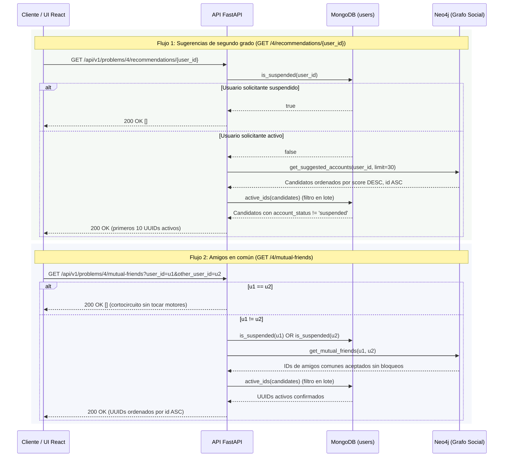

# Problema 04 — Amigos en común y sugerencias de cuentas

## Qué está implementado

Implementado combinando **Neo4j** como motor principal del grafo social (`FOLLOWS` y `BLOCKS`) y
**MongoDB** (`users`) como fuente de verdad autoritativa del estado de cada cuenta
(`account_status: active | suspended`). Al tratarse de consultas de lectura sincrónicas (`GET`),
la API responde **200 OK** con la tupla ordenada de UUIDs sin encolar jobs ni requerir procesos
workers adicionales. Tampoco existe bypass de modo demo: ambos endpoints ejecutan siempre las
consultas reales sobre Neo4j y MongoDB.

El caso de uso `SocialRecommendationsUseCase` resuelve dos operaciones complementarias:

- **Amigos en común (`mutual_friends`):** obtiene todas las cuentas activas que son seguidas de
  forma aceptada simultáneamente por `user_id` y `other_user_id`, excluyendo bloqueos en cualquier
  dirección y cuentas suspendidas.
- **Sugerencias de segundo grado (`recommendations`):** recomienda hasta **10** cuentas activas
  seguidas por los contactos aceptados del usuario (`(u)-[:FOLLOWS]->(middle)-[:FOLLOWS]->(candidate)`),
  ordenadas por cantidad de conexiones intermedias distintas (`score DESC`) y desempate
  determinista por identificador (`id ASC`).

## Secuencia, consultas Cypher y validación cruzada



### 1. Consulta Cypher de amigos en común (`get_mutual_friends`)

```cypher
MATCH (u1:User {id:$u1})-[r1:FOLLOWS]->(f:User)
      <-[r2:FOLLOWS]-(u2:User {id:$u2})
WHERE f <> u1 AND f <> u2
  AND coalesce(r1.status,'accepted')='accepted'
  AND coalesce(r2.status,'accepted')='accepted'
  AND coalesce(u1.account_status,'active')='active'
  AND coalesce(u2.account_status,'active')='active'
  AND coalesce(f.account_status,'active')='active'
  AND NOT (u1)-[:BLOCKS]-(f)
  AND NOT (u2)-[:BLOCKS]-(f)
  AND NOT (u1)-[:BLOCKS]-(u2)
RETURN DISTINCT f.id AS id ORDER BY id
```

- Exige que ambas relaciones `FOLLOWS` estén aceptadas (`coalesce(r.status, 'accepted') = 'accepted'`),
  manteniendo compatibilidad con datos sembrados sin propiedad `status` y excluyendo solicitudes
  de seguimiento `pending` en cuentas privadas (P2).
- Si existe una arista `BLOCKS` en cualquier sentido entre `(u1, f)`, `(u2, f)` o entre los propios
  usuarios consultados `(u1, u2)`, el candidato (o toda la consulta entre ambos) queda excluido.
- `RETURN DISTINCT f.id AS id ORDER BY id` garantiza idempotencia de lectura y un orden lexicográfico
  determinista de UUIDs.

### 2. Consulta Cypher de sugerencias de segundo grado (`get_suggested_accounts`)

```cypher
MATCH (u:User {id:$id})-[r1:FOLLOWS]->(middle:User)
      -[r2:FOLLOWS]->(candidate:User)
WHERE candidate <> u
  AND coalesce(r1.status,'accepted')='accepted'
  AND coalesce(r2.status,'accepted')='accepted'
  AND coalesce(u.account_status,'active')='active'
  AND coalesce(middle.account_status,'active')='active'
  AND coalesce(candidate.account_status,'active')='active'
  AND NOT (u)-[:FOLLOWS]->(candidate)
  AND NOT (u)-[:BLOCKS]-(middle)
  AND NOT (middle)-[:BLOCKS]-(candidate)
  AND NOT (u)-[:BLOCKS]-(candidate)
RETURN candidate.id AS id, count(DISTINCT middle) AS score
ORDER BY score DESC, id LIMIT $limit
```

- Recorre caminos de longitud 2 sobre seguimientos aceptados `u -> middle -> candidate`.
- Descarta auto-sugerencias (`candidate <> u`), cuentas a las que `u` ya sigue o ya solicitó seguir
  (`NOT (u)-[:FOLLOWS]->(candidate)`, cubriendo tanto `accepted` como `pending`), y cualquier camino
  donde exista un bloqueo entre `u` y `middle`, entre `middle` y `candidate`, o entre `u` y `candidate`.
- Calcula el puntaje como `count(DISTINCT middle)` (cantidad de contactos seguidos distintos que
  conectan a `u` con `candidate`) y desempata de forma determinista por `id` ascendente.

## Determinismo, concurrencia y coordinación con P2 y P8

| Escenario | Garantía implementada |
|---|---|
| Consulta `mutual-friends` con `user_id == other_user_id` | Cortocircuito inmediato en `SocialRecommendationsUseCase` y en el repositorio; devuelve `()` sin consultar bases. |
| Grafo sin candidatos para el usuario | Si Neo4j devuelve `()`, no se realiza la consulta `$in` vacía a MongoDB. |
| Solicitud de seguimiento pendiente en cuenta privada (P2) | No genera amigos en común ni puentes de segundo grado, pero sí impide volver a sugerir esa cuenta a quien ya envió la solicitud (`NOT (u)-[:FOLLOWS]->(candidate)`). |
| Suspensión en curso o reciente (P8) | En P8 (`AccountProcessor`), MongoDB marca `account_status = 'suspended'` antes de actualizar Neo4j. La doble verificación (`is_suspended` para los extremos y `active_ids` por lote para los resultados) evita filtrar o recomendar cuentas recién suspendidas. |
| Candidatos del top 10 recién suspendidos en MongoDB | `recommendations` solicita un pool de hasta 30 candidatos a Neo4j (`_CANDIDATE_POOL_LIMIT = 30`), filtra con `active_ids` en MongoDB conservando el orden de ranking y recorta a los primeros 10 (`_SUGGESTIONS_LIMIT = 10`). |
| Intermediario (`middle`) suspendido o bloqueado | Excluido en Cypher (`coalesce(middle.account_status, 'active') = 'active'` y `NOT (u)-[:BLOCKS]-(middle)`): un nodo suspendido o bloqueado nunca actúa como puente de recomendación. |
| Dependencia caída (MongoDB o Neo4j no disponibles) | Propaga el error de infraestructura y devuelve **503 Service Unavailable**, sin simular respuestas vacías ni usar datos demo. |

Al ser operaciones exclusivamente de lectura, no requieren claves de idempotencia, bloqueos de
escritura ni pasos de compensación.

## API, prueba manual con Swagger y frontend

### Endpoints HTTP

1. **`GET /api/v1/problems/4/recommendations/{user_id}`**
   - Parámetro de ruta: `user_id` (UUID v4).
   - Respuesta `200 OK`: lista JSON de hasta 10 UUIDs de cuentas sugeridas ordenadas por relevancia.
2. **`GET /api/v1/problems/4/mutual-friends?user_id={u1}&other_user_id={u2}`**
   - Parámetros de query validados por `MutualFriendsRequest`: `user_id` (UUID) y `other_user_id` (UUID).
   - Respuesta `200 OK`: lista JSON de UUIDs de amigos en común ordenados por identificador.

### Paso a paso en Swagger (`http://localhost:8000/docs`)

1. Registrar usuarios en `POST /api/v1/users` e iniciar sesión en `POST /api/v1/users/login`.
2. Autorizar con el `access_token` en **Authorize** y crear seguimientos con `POST /api/v1/social/follows`,
   esperando a que `GET /api/v1/social/operations/{operation_id}` indique `completed`.
3. Ejecutar `GET /api/v1/problems/4/recommendations/{user_id}` con el UUID del usuario origen para
   obtener sugerencias de segundo grado.
4. Ejecutar `GET /api/v1/problems/4/mutual-friends` indicando `user_id` y `other_user_id` para
   verificar las cuentas seguidas en común.

### Pantalla en el frontend React (`/recomendaciones`)

La SPA incorpora el módulo `frontend/src/features/recommendations/` accesible desde la barra de
navegación lateral/inferior bajo **Sugerencias** (`/recomendaciones`, ruta protegida por sesión):

- **Sección Cuentas sugeridas:** consulta `GET /api/v1/problems/4/recommendations/{user.id}`,
  renderiza cada candidato mediante `UserCard` (que carga `GET /api/v1/users/{id}` con caché
  compartida de 5 minutos en TanStack Query y oculta cuentas no disponibles con `404`), permite
  refrescar sugerencias y ofrece el botón **"Ver amigos en común"** en cada tarjeta para cargar
  automáticamente ese UUID en el buscador inferior.
- **Sección Consultar amigos en común:** formulario con validación previa en cliente (impide vacío,
  impide consultar la propia cuenta y valida formato UUID con Zod `mutualFriendsQuerySchema` antes
  de emitir el request) y grilla de tarjetas con los perfiles resultantes.

## Ejecución y defensa

Con Docker Compose levantado:

```powershell
docker compose up -d --build
Get-Content -Raw scripts/validar_problema4.py | docker compose exec -T api python -
```

En Git Bash:

```bash
docker compose exec -T api python < scripts/validar_problema4.py
```

El script `scripts/validar_problema4.py` crea cinco usuarios QA aislados (`usera`, `userb`,
`common`, `target`, `target2`) con contraseñas aleatorias, ejecuta seguimientos reales a través
del worker de P2 (`A -> Common`, `A -> B`, `B -> Common`, `B -> Target`, `Common -> Target`,
`Common -> Target2`) y comprueba:

1. Que `GET /api/v1/problems/4/mutual-friends` entre `usera` y `userb` detecte a `common` sin
   incluir a los propios consultados.
2. Que consultar amigos en común consigo mismo (`usera` y `usera`) devuelva `[]`.
3. Que `GET /api/v1/problems/4/recommendations/{usera}` sugiera a `target` (puntaje 2, vía `common`
   y `userb`) antes que a `target2` (puntaje 1, solo vía `common`), excluya a `common`, `userb` y
   `usera`, y respete el tope de 10 resultados.

## Ubicación

- **API Router:** `app/api/v1/routers/problems.py` (`/4/recommendations/{user_id}` y `/4/mutual-friends`)
- **Inyección de dependencias:** `app/api/dependencies/use_cases.py` (`get_recommendations_use_case`)
- **Caso de uso:** `app/application/use_cases/problem_04_social_recommendations.py` (`SocialRecommendationsUseCase`)
- **Puertos de dominio:** `app/domain/repositories/social_graph_repository.py` y `app/domain/repositories/user_repository.py`
- **Repositorio Neo4j:** `app/infrastructure/persistence/neo4j/repositories/social_graph_repository.py` (`get_mutual_friends`, `get_suggested_accounts`)
- **Repositorio MongoDB:** `app/infrastructure/persistence/mongodb/repositories/identity.py` (`is_suspended`, `active_ids`)
- **Frontend React:** `frontend/src/features/recommendations/RecommendationsPage.tsx`, `UserCard.tsx`, `api.ts`, `contracts.ts` y `frontend/src/styles/recommendations.css`
- **Script HTTP reproducible:** `scripts/validar_problema4.py`
- **Pruebas unitarias Backend:** `tests/unit/test_problem_04_recommendations.py`
- **Pruebas de integración Backend:** `tests/integration/test_problem_04_recommendations.py` y regresiones cruzadas en `tests/integration/test_problem_08_accounts.py`
- **Pruebas unitarias/componentes Frontend:** `frontend/src/features/recommendations/RecommendationsPage.test.tsx`

## Evidencia de esta implementación

- **Tests unitarios Python (`tests/unit/test_problem_04_recommendations.py`):** 8 pruebas aprobadas
  (cortocircuito mismo usuario, solicitante suspendido, objetivo suspendido, filtrado de candidatos
  suspendidos en amigos en común y sugerencias, cortocircuito sin candidatos en Neo4j y
  sobremuestreo de 30 candidatos con recorte a 10 activos).
- **Tests de integración real (`tests/integration/test_problem_04_recommendations.py`):** 4 pruebas
  contra MongoDB y Neo4j reales (orden determinista, exclusión de solicitudes `pending` y bloqueos
  directos o entre consultados, ranking por `score DESC` excluyendo ya seguidos/puentes bloqueados,
  y sobremuestreo cuando MongoDB suspende candidatos antes de impactar en Neo4j), más las pruebas
  de exclusión de cuenta e intermediario suspendido en `tests/integration/test_problem_08_accounts.py`.
- **Tests de Frontend (`RecommendationsPage.test.tsx`):** 5 pruebas con Vitest y Testing Library
  (estado vacío, renderizado de tarjetas y perfiles asociados, rechazo de auto-consulta, validación
  de UUID inválido y búsqueda de amigos en común).
- **Calidad estática y smoke HTTP:** `ruff check` sin errores en todos los módulos modificados y
  validación end-to-end exitosa con `scripts/validar_problema4.py`.
