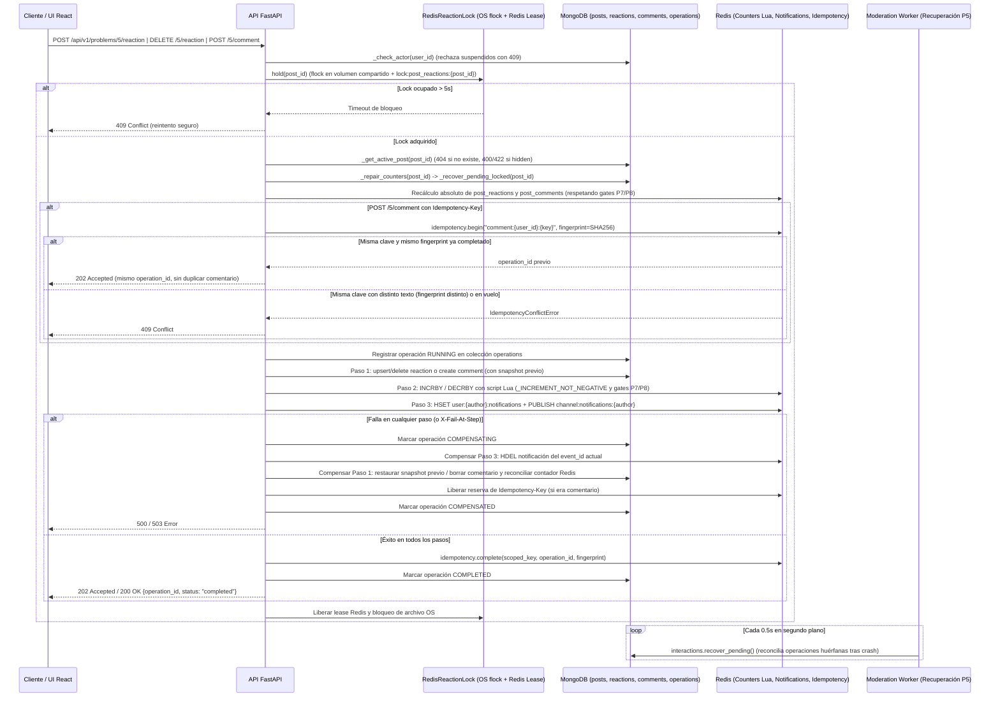

# Problema 05 — Reacciones y comentarios con consistencia entre motores

## Qué está implementado

Implementado en `InteractWithPostUseCase` combinando **MongoDB** como fuente de verdad documental
(`posts`, `reactions`, `comments` y `operations`) y **Redis** para los contadores atómicos
(`post_reactions:{post_id}:count`, `post_comments:{post_id}:count`), las notificaciones persistidas y en
vivo (`user:{author_id}:notifications` + Pub/Sub `channel:notifications:{author_id}`), las reservas de
idempotencia (`idempotency:*`) y el lease distribuido por publicación (`lock:post_reactions:{post_id}`).

El caso de uso resuelve tres operaciones sobre una publicación activa y aprobada:

- **Alta o cambio de reacción (`react` / `problem_05_react`):** garantiza a lo sumo una reacción por par
  `(post_id, user_id)` mediante el índice único `uq_reaction_post_user` en MongoDB. Si el usuario no tenía
  reacción previa, inserta el documento, incrementa `post_reactions:{post_id}:count` en 1 y publica la
  notificación al autor (si `author_id != user_id`). Si ya existía una reacción previa, actualiza `kind`
  en el lugar sin volver a incrementar el contador ni duplicar la notificación.
- **Baja de reacción (`remove_reaction` / `problem_05_remove_reaction`):** elimina la reacción del usuario
  en MongoDB y sólo decrementa el contador en Redis si efectivamente existía un documento previo, haciendo
  que los borrados repetidos o concurrentes sean idempotentes y nunca dejen contadores negativos.
- **Creación de comentario (`comment` / `problem_05_comment`):** inserta el comentario en la colección
  separada `comments` (indexada por `ix_comment_post_created` sobre `(post_id ASC, created_at DESC)` para
  evitar el crecimiento ilimitado del documento `Post`), incrementa `post_comments:{post_id}:count`,
  notifica al autor y soporta `Idempotency-Key` acotada por usuario con validación de fingerprint SHA-256.

## Secuencia, pasos compensables y estructuras en MongoDB/Redis



### Pasos de ejecución y compensación (`CompensationService`)

Cada operación se registra en la colección `operations` de MongoDB antes de ejecutar sus pasos y declara
`compensate_on_failure=True` para cubrir fallos parciales dentro del propio paso:

| Operación (`operation_type`) | Paso (`OperationStep`) | Acción directa | Compensación en orden inverso (`rollback`) |
|---|---|---|---|
| `problem_05_react` | 1. `mongo_upsert_reaction` | Lee snapshot previo (`get_for_user`), guarda `previous_id` y `previous_kind` en `metadata` y ejecuta `find_one_and_update(..., upsert=True)`. | Si `previous` era `None`, ejecuta `delete_for_user`; si existía, restaura `upsert(state.previous)`. Al final recalcula el contador absoluto en Redis desde MongoDB. |
| `problem_05_react` | 2. `redis_increment_reaction_counter` | Si `state.previous is None`, incrementa `post_reactions:{post_id}:count` en `+1` vía Lua. | La reconciliación exacta del contador ocurre tras restaurar MongoDB en el paso 1 (o con fallback `-1` si no hay conteo directo). |
| `problem_05_react` | 3. `redis_publish_notification` | Si `state.previous is None` y `author_id != user_id`, escribe `HSET user:{author}:notifications {event_id}` y emite `PUBLISH channel:notifications:{author}`. | Ejecuta `HDEL user:{author}:notifications {event_id}` usando el UUID único de esta reacción, sin borrar notificaciones de reacciones anteriores. |
| `problem_05_remove_reaction` | 1. `mongo_delete_reaction` | Lee snapshot previo, guarda `removed_id` y `removed_kind` en `metadata` y ejecuta `find_one_and_delete`. | Si había reacción previa, la restaura con `upsert(state.removed)` y recalcula el contador absoluto en Redis. |
| `problem_05_remove_reaction` | 2. `redis_decrement_reaction_counter` | Si `state.removed is not None`, decrementa `post_reactions:{post_id}:count` en `-1` vía Lua (con piso en `0`). | Cubierto por el recálculo absoluto al restaurar MongoDB en el paso 1. |
| `problem_05_comment` | 1. `mongo_create_comment` | Inserta el documento en `comments` (`insert_one` idempotente ante `DuplicateKeyError`). | Elimina el comentario por `_id` (`delete_one`) y recalcula `post_comments:{post_id}:count` desde MongoDB. |
| `problem_05_comment` | 2. `redis_increment_comment_counter` | Incrementa `post_comments:{post_id}:count` en `+1` vía Lua. | Cubierto por el recálculo absoluto tras eliminar el comentario en MongoDB. |
| `problem_05_comment` | 3. `redis_publish_notification` | Si `author_id != user_id`, ejecuta `HSET` + `PUBLISH` con `event_id = comment.id`. | Ejecuta `HDEL user:{author}:notifications {comment.id}`. |

## Exclusión mutua, idempotencia, coordinación P7/P8 y recuperación tras caída

### 1. Bloqueo híbrido por publicación (`RedisReactionLock`)

Las altas, cambios y bajas de reacciones y los comentarios sobre un mismo `post_id` adquieren el bloqueo
común `RedisReactionLock.hold(post_id)` durante toda la operación (lectura de snapshot, escritura en
MongoDB, actualización de contador, notificación y eventual compensación):

- **Bloqueo autoritativo de sistema operativo (`_host_hold`):** abre `{P5_LOCK_DIRECTORY}/{post_id}.lock`
  (compartido entre contenedores del host mediante el volumen `interaction_locks`) y adquiere un bloqueo
  exclusivo no bloqueante (`fcntl.flock` en Linux / `msvcrt.locking` en Windows) con reintentos hasta
  `blocking_timeout = 5.0` segundos. Si un proceso se pausa (GC o saturación de CPU) y su lease Redis vence,
  el bloqueo de archivo del SO impide que un segundo escritor se solape. Si el proceso muere (`SIGKILL` o
  caída del contenedor), el kernel libera el descriptor inmediatamente.
- **Lease Redis con heartbeat (`_redis_hold`):** adquiere `lock:post_reactions:{post_id}` con TTL de 30 s
  y una tarea `_heartbeat` que renueva el lease cada 10 s (`lease_seconds / 3`). Si no se consigue el
  bloqueo en 5 segundos, la API responde **409 Conflict** para que el cliente reintente sin corromper el estado.

### 2. Idempotencia y fingerprint en comentarios

- Cuando el cliente envía la cabecera `Idempotency-Key`, el caso de uso construye la clave acotada al autor
  `scoped_key = f"comment:{comment.user_id}:{idempotency_key}"` y el hash de contenido
  `fingerprint = SHA256("{post_id}:{user_id}:{text}")`.
- Si se reintenta el mismo comentario con igual `Idempotency-Key` y mismo texto, `IdempotencyService.begin`
  devuelve el `operation_id` original con estado `completed` (`202 Accepted`) sin volver a insertar en
  MongoDB ni incrementar el contador.
- Si se reutiliza la misma `Idempotency-Key` con un texto o `post_id` distinto (`fingerprint` diferente),
  o mientras la primera solicitud sigue reservada en vuelo, se lanza `ConflictError` (**409 Conflict**).
- Si la ejecución falla y se compensa, se libera la reserva (`idempotency.release(scoped_key)`) en el bloque
  `except`, permitiendo que el cliente reintente con la misma clave.

### 3. Coordinación atómica con Moderación (P7) y Suspensión (P8)

Tanto `RedisCounterRepository.increment` como `RedisCounterRepository.set_value` ejecutan scripts Lua en
el servidor Redis que verifican la existencia de los gates `moderation:{post_id}:hidden` (P7) y
`suspension:{post_id}:hidden` (P8):

- Si cualquiera de los dos gates está activo, el contador público (`post_reactions:{post_id}:count` o
  `post_comments:{post_id}:count`) se mantiene en `0` y el valor real se escribe o incrementa sobre la
  clave de respaldo `:moderation_saved`.
- Cuando P7 o P8 retiran el último gate activo, restauran el valor acumulado en `:moderation_saved` sin
  perder interacciones ni reconciliaciones ocurridas en el borde de la transición.

### 4. Recuperación durable automática tras caída (`recover_pending`)

Si la API o el proceso muere abruptamente a mitad de una operación (dejándola en estado `running`,
`pending` o `compensating` en la colección `operations`), la recuperación ocurre automáticamente por dos
vías complementarias:

1. **En caliente al ingresar el siguiente escritor (`_repair_counters`):** antes de ejecutar cualquier nueva
   reacción o comentario sobre `post_id`, se invoca `_recover_pending_locked(post_id)` bajo el bloqueo de la
   publicación y luego se recalculan ambos contadores desde MongoDB.
2. **En segundo plano (`app/workers/moderation.py`):** el bucle de `moderation-worker` invoca cada 0,5 s
   `await interactions.recover_pending()`, reconciliando cualquier operación P5 pendiente incluso si nadie
   vuelve a interactuar con ese post:
   - **`problem_05_react` interrumpida en `running`/`pending`:** si la reacción nueva (`current.id == event_id`)
     se persistió en MongoDB, recalcula el contador, publica la notificación pendiente al autor y marca
     `completed`. Si era un cambio de tipo en el lugar (`current.kind == kind`), recalcula el contador y
     marca `completed` sin duplicar notificación. Si no llegó a MongoDB, recalcula el contador y marca `failed`.
   - **`problem_05_react` interrumpida en `compensating`:** si existía `previous_kind` en `metadata`,
     restaura la reacción anterior en MongoDB; si era un alta nueva, la elimina, revoca la notificación y
     marca `compensated`.
   - **`problem_05_remove_reaction` interrumpida:** en `compensating`, si la reacción ya había sido borrada
     y `removed_kind` figura en `metadata`, la vuelve a insertar en MongoDB, recalcula el contador y marca
     `compensated`. En `running`/`pending`, recalcula el contador y marca `completed` si el documento ya no
     existe en MongoDB, o `failed` si el corte ocurrió antes del borrado.
   - **`problem_05_comment` interrumpida:** si el comentario existe en MongoDB y el estado no era
     `compensating`, recalcula el contador, emite la notificación al autor, completa la `Idempotency-Key`
     con el `fingerprint` y marca `completed`. Si no llegó a persistirse o estaba en `compensating`, elimina
     cualquier rastro, revoca la notificación, libera la `Idempotency-Key` (`release`) y marca `failed` o
     `compensated`.

## API, prueba manual con Swagger y frontend

### Endpoints HTTP

1. **`POST /api/v1/problems/5/reaction`** (`202 Accepted` -> `OperationResponse {operation_id, status}`)
   - Body JSON (`ReactionCreate`): `{"post_id": UUID, "user_id": UUID, "kind": "like" | "love" | ... (1..30 chars)}`.
2. **`DELETE /api/v1/problems/5/reaction`** (`200 OK` -> `OperationResponse {operation_id, status}`)
   - Body JSON (`ReactionRemove`): `{"post_id": UUID, "user_id": UUID}`.
3. **`POST /api/v1/problems/5/comment`** (`202 Accepted` -> `OperationResponse {operation_id, status}`)
   - Header opcional: `Idempotency-Key` (1..200 caracteres).
   - Body JSON (`CommentCreate`): `{"post_id": UUID, "user_id": UUID, "text": "1..2000 chars"}`.
4. **Rutas alias sin cuerpo (`204 No Content`) en `app/api/v1/routers/interactions.py`:**
   - `POST /api/v1/interactions/reactions`, `DELETE /api/v1/interactions/reactions` y `POST /api/v1/interactions/comments`.

### Paso a paso en Swagger (`http://localhost:8000/docs`)

1. Obtener un `post_id` activo (por ejemplo, el post de `Lautaro`: `c3fc5f73-fa6c-4a34-bc63-a4a0b8bde111`)
   y un `user_id` activo (por ejemplo, `rosariobonata`: `aaf5a730-8863-444a-a551-bd8325bd308d`).
2. Ejecutar `POST /api/v1/problems/5/reaction` con `{"post_id": "...", "user_id": "...", "kind": "like"}` y
   verificar que `GET /api/v1/posts/{post_id}` incremente `reaction_count`.
3. Enviar nuevamente `POST /api/v1/problems/5/reaction` con `"kind": "love"` y comprobar que `reaction_count`
   se mantiene sin duplicarse.
4. Ejecutar `POST /api/v1/problems/5/comment` enviando un header `Idempotency-Key: demo-comentario-1`.
   Repetir el mismo request con igual clave y comprobar que devuelve el mismo `operation_id` sin incrementar
   de nuevo `comment_count`; repetir con igual clave y distinto `text` y comprobar que responde **409 Conflict**.
5. En entorno `development`, probar `X-Fail-At-Step` con cualquiera de los valores soportados:
   - Para reacciones: `mongo_upsert_reaction`, `redis_increment_reaction_counter`, `redis_publish_notification`.
   - Para baja de reacción: `mongo_delete_reaction`, `redis_decrement_reaction_counter`.
   - Para comentarios: `mongo_create_comment`, `redis_increment_comment_counter`, `redis_publish_notification`.

### Interacciones en el frontend React (`PostInteractions`)

Cada tarjeta de publicación (`PostCard` en `/` y `/mis-publicaciones`) integra el componente
`frontend/src/features/interactions/PostInteractions.tsx`:

- **Barra de reacciones:** ofrece botones rápidos (`👍 Me gusta`, `❤️ Me encanta`, `🎉 Celebrar`,
  `💡 Interesante`), la opción **`＋ Otra`** para ingresar una reacción personalizada (1 a 30 caracteres,
  validada con `reactionPayloadSchema`) y el botón **`Quitar mi reacción`** cuando el usuario reaccionó.
- **Formulario de comentarios:** desplegable con **`💬 Escribir comentario`**, contador de longitud
  (`0 / 2.000`), validación con `commentPayloadSchema` y envío con cabecera `Idempotency-Key` UUID v4.
  Si ocurre un error de red o un `409 Conflict`, conserva tanto el texto escrito como la misma
  `Idempotency-Key` para que el reintento sea seguro; solo genera un nuevo UUID cuando el envío tiene éxito.
- **Fuente de verdad del servidor:** tras cada reacción, baja o comentario exitoso, invoca
  `refreshPostCounters` (`GET /api/v1/posts/{postId}`) y actualiza los contadores visibles desde el backend.

### Usuarios, contraseñas y datos de prueba para Problema 5

| Recurso / Usuario | Identificador (`UUID` / Username) | Contraseña | Uso en pruebas de Problema 5 |
|---|---|---|---|
| Usuario interactuante (`rosariobonata`) | `aaf5a730-8863-444a-a551-bd8325bd308d` | `123456789` | Iniciar sesión en UI (`/login`) y reaccionar/comentar sobre publicaciones del feed o Swagger |
| Autor con post publicado (`Lautaro`) | `11111111-1111-4111-8111-111111111111` | `12345678` | Autor de la publicación `c3fc5f73-fa6c-4a34-bc63-a4a0b8bde111` visible en el feed de sus seguidores |
| Seguidor con post en feed (`lautaro1`) | `a8debe19-def9-5b85-870e-13848e1ef956` | `12345678` | Iniciar sesión en `/` para ver la tarjeta de `Lautaro` y probar `PostInteractions` directamente en pantalla |
| Publicación activa en vivo (`post_id`) | `c3fc5f73-fa6c-4a34-bc63-a4a0b8bde111` | — | Post público de `Lautaro` para probar reacciones, bajas, comentarios e idempotencia en Swagger |
| Usuarios QA Problema 4 (`qa-p4-832003b7-usera`, etc.) | `b07b4b02-077a-4182-9cf2-b5b6b5a551b8` | `123456789` | Cuentas activas adicionales con clave unificada |

## Ejecución y defensa

Con Docker Compose levantado, existen dos scripts complementarios para defender el problema:

### 1. Smoke HTTP, idempotencia, compensaciones y alta concurrencia (`scripts/validar_problema5.py`)

En PowerShell:

```powershell
Get-Content -Raw scripts/validar_problema5.py | docker compose exec -T api python -
```

En Git Bash:

```bash
docker compose exec -T api python < scripts/validar_problema5.py
```

Ejecuta **16 comprobaciones automatizadas** contra MongoDB y Redis reales e imprime `SUMMARY {"passed": 16, "total": 16}`:
1. Creación de reacción (`202`) y verificación `(docs_mongo=1, redis_count=1, ["like"])`.
2. Persistencia de notificación en el Hash Redis del autor (`user:{author}:notifications`).
3. Repetición de la misma reacción sin duplicar documentos ni inflar el contador.
4. Cambio de tipo de reacción (`"like"` -> `"love"`) manteniendo `(1, 1, ["love"])`.
5. Eliminación de reacción (`DELETE /5/reaction`) dejando `(0, 0)`.
6. Repetición de borrado sin bajar de `0`.
7. Compensación ante falla inyectada en los 3 pasos de reacción (`mongo_upsert_reaction`,
   `redis_increment_reaction_counter`, `redis_publish_notification`).
8. Creación de comentario con `Idempotency-Key` y replay idempotente (misma respuesta `202` y `(1, 1)`).
9. Verificación de notificación de tipo `"comment"` en el Hash del autor.
10. Compensación ante falla inyectada en los 3 pasos de comentario (`mongo_create_comment`,
    `redis_increment_comment_counter`, `redis_publish_notification`).
11. Ráfaga de **20 reacciones concurrentes** del mismo usuario -> estado final exacto `(1, 1)`.
12. Ráfaga de **20 borrados concurrentes** -> estado final exacto `(0, 0)`.
13. Ráfaga de **20 comentarios concurrentes** con la misma `Idempotency-Key` -> respuestas en `(202, 409)` y un único comentario nuevo persistido.
14. **30 rondas de solapamiento `POST` + `DELETE` simultáneos** verificando que nunca diverjan MongoDB y Redis.

### 2. Fallas parciales intra-paso y solapamiento controlado (`scripts/validar_problema5_fallas.py`)

En PowerShell:

```powershell
Get-Content -Raw scripts/validar_problema5_fallas.py | docker compose exec -T api python -
```

En Git Bash:

```bash
docker compose exec -T api python < scripts/validar_problema5_fallas.py
```

Comprueba dos escenarios deterministas de bajo nivel:
1. **Fallo entre `HSET` y `PUBLISH` en Redis (`FailPublishClient`):** verifica que, aunque `publish` falle
   después de haber guardado la notificación en el Hash, la compensación del propio paso ejecuta `HDEL`,
   revierte el contador y borra la reacción en MongoDB (`reactions_mongo=0`, `counter_redis=0`,
   `notifications_remaining=0`).
2. **Pausa dentro de `upsert` con `remove_reaction` concurrente (`PausedReactions`):** verifica que el
   borrado espera el bloqueo `RedisReactionLock` hasta que termina el alta y deja ambos motores en `(0, 0)`.

## Ubicación

- **API Routers:** `app/api/v1/routers/problems.py` (`/5/reaction`, `/5/comment`) y `app/api/v1/routers/interactions.py` (`/interactions/reactions`, `/interactions/comments`)
- **Inyección de dependencias:** `app/api/dependencies/use_cases.py` (`get_interaction_use_case`)
- **Caso de uso y recuperación:** `app/application/use_cases/problem_05_interact_with_post.py` (`InteractWithPostUseCase`)
- **Puerto y adaptador de bloqueo híbrido:** `app/application/ports/reaction_lock.py` y `app/infrastructure/persistence/redis/reaction_lock.py` (`RedisReactionLock`)
- **Repositorios MongoDB:** `app/infrastructure/persistence/mongodb/repositories/content_repositories.py` (`MongoReactionRepository`, `MongoCommentRepository`) y `operation_log.py` (`MongoOperationLogRepository`)
- **Repositorios Redis:** `app/infrastructure/persistence/redis/repositories/operational_repositories.py` (`RedisCounterRepository`, `RedisNotificationRepository`, `RedisIdempotencyRepository`)
- **Worker de recuperación en segundo plano:** `app/workers/moderation.py` (`interactions.recover_pending()`)
- **Frontend React:** `frontend/src/features/interactions/PostInteractions.tsx`, `api.ts`, `contracts.ts`, `frontend/src/features/posts/PostCard.tsx` y `frontend/src/styles/interactions.css`
- **Scripts reproducibles:** `scripts/validar_problema5.py` y `scripts/validar_problema5_fallas.py`
- **Pruebas unitarias Backend:** `tests/unit/test_problem_05_regressions.py`
- **Pruebas de integración Backend:** `tests/integration/test_problem_05_consistency.py`
- **Pruebas de componentes Frontend:** `frontend/src/features/interactions/PostInteractions.test.tsx`

## Evidencia de esta implementación

- **Tests unitarios Python (`tests/unit/test_problem_05_regressions.py`):** 14 pruebas aprobadas
  (compensación de fallo parcial en notificación para reacción y comentario, espera de bloqueo entre alta y
  baja, liberación de lock ante excepción, rechazo 409 por distinto fingerprint en comentario, reconciliación
  idempotente ante timeout incierto en Redis, lease acotado en `RedisReactionLock`, y recuperación tras caída
  para alta de reacción, cambio de reacción en el lugar, compensación de cambio de reacción, baja de reacción
  en estados `running`/`compensating`, comentario completado y liberación de clave de comentario fallido).
- **Tests de integración real (`tests/integration/test_problem_05_consistency.py`):** 11 pruebas contra
  MongoDB y Redis reales (compensaciones end-to-end, pérdida de ACK en decremento Redis, preservación de
  contadores bajo gates de moderación P7 y suspensión P8, expiración de lock huérfano, pérdida de respuesta
  en MongoDB al cambiar o borrar reacción, concurrencia entre comentario fallido y exitoso, reparación de
  contador de comentarios, exclusión por bloqueo de SO con lease Redis vencido, crash de subproceso real y
  recuperación durable automática).
- **Tests de Frontend (`PostInteractions.test.tsx`):** 7 pruebas con Vitest y Testing Library (renderizado de
  controles, envío de reacción predefinida, envío de reacción personalizada, eliminación de reacción,
  bloqueo de comentario vacío, envío con `Idempotency-Key` y preservación del texto/clave ante error `409`).
- **Guía complementaria de consistencia:** `docs/problem_05_consistency.md`.
