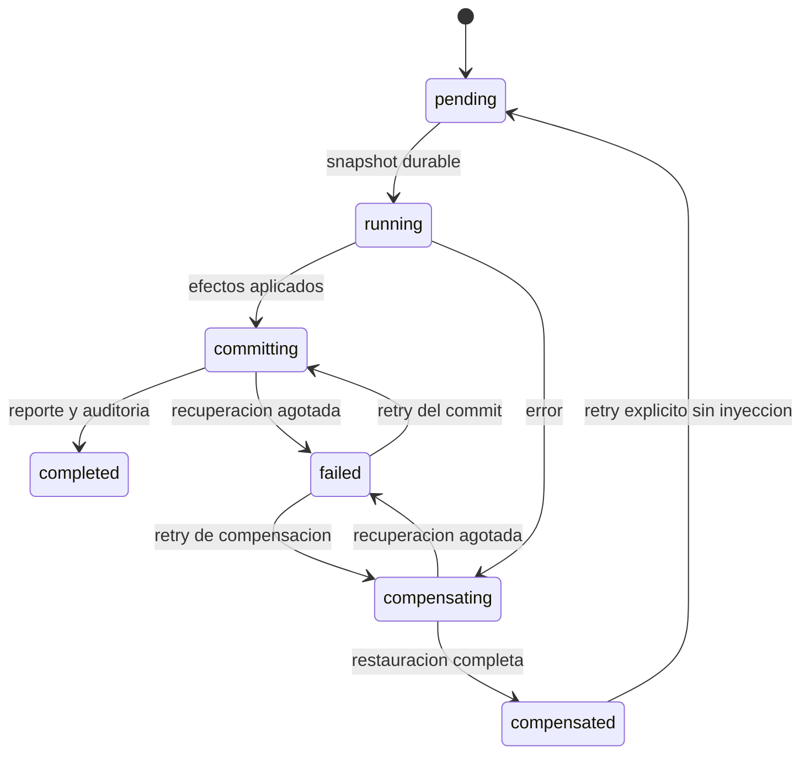

# Problema 07 — Moderación

**Estado: implementado y validado contra MongoDB/Redis reales.**

## Capas

Router → ModeratePostUseCase / IdentityService / ContentQueries → puertos de dominio/aplicación
→ MongoModerationRepository, MongoUserRepository, MongoPostRepository y RedisModerationViews.
El router no consulta motores. ModeratePostUseCase encola; ModerationProcessor ejecuta efectos.
La autenticación completa los PasswordHasher/TokenService existentes, antes vacíos, con PBKDF2
SHA256 (600000 iteraciones, salt aleatorio) y bearer HMAC-SHA256 con sujeto/expiración.
No existían roles implementados: User ahora conserva user/moderator/admin. La API nunca asigna
un rol privilegiado por registro; el seed de desarrollo crea los actores de demostración.

## Datos

- `users`: UUID, identidad/hash, estado y rol; índices únicos username/email.
- `moderation_reports`: UUID, post_id, target_type=post, reporter_id, reason, description,
  resolution_status (pending/approved/rejected/reverted), fechas, moderador y última decisión.
  Único (post_id, reporter_id); índices por estado/fecha y moderador.
- `moderation_jobs`: UUID determinista por reporte y tipo decision/revert, actor, acción, motivo,
  status, active, snapshot/restore, completed_steps, failures, error, resume_phase y fechas.
  Índice único parcial post_id donde active=true; índice de cola status/created_at.
- `moderation_history`: evento por operation_id (upsert idempotente), post/reporte/actor,
  acción, motivo, fecha, snapshot anterior y estado resultante del reporte.
- `posts`: conserva moderation_status y moderation_owner para validar qué reporte puede revertir.
- Redis: `moderation:<post>:hidden`; contadores públicos y sufijo `:moderation_saved`;
  `feed:<user>` conserva el mismo sorted set del P1. No se crea un contador ajeno al modelo.

## Workflow

Hide: persistir snapshot → ocultar en Mongo → gate/contadores Redis atómicos → ZREM por lotes
→ decidir commit durable → actualizar reporte/auditoría → liberar exclusión.
Revert: preservar snapshot oculto → ZADD de los feeds anteriores y restaurar contadores
→ restaurar moderation_status/owner Mongo → commit/auditoría.
Rechazo no modifica contenido ni derivados. Las fallas previas a committing compensan;
una vez en committing se completa la decisión sin rollback. Los jobs conservan evidencia
asimismo de fallas, compensaciones y reintentos, aunque no generen una resolución exitosa.

Compensar hide restaura Redis antes de abrir Mongo. Compensar revert oculta Mongo primero,
reaplica gate/contadores y elimina los feeds de su hide original. Un fallo de compensación
retiene active=true para impedir que otra decisión pise el estado recuperable.

## Concurrencia e idempotencia

| Carrera | Resolución |
|---|---|
| Dos decisiones iguales | Mismo UUID de job; se devuelve el original |
| Dos decisiones distintas del mismo reporte | UUID único + comparación de payload: 409 |
| Dos reportes del mismo post | Índice único parcial de operación activa |
| Revert durante hide | 409 hasta que hide esté completed |
| Replay de hide durante revert | Devuelve hide completed, no repite efectos |
| Dos retries | Compare-and-set del estado terminal; uno recibe 409 |
| Proceso muere después de Redis, antes del checkpoint | Replay de Lua/ZADD/ZREM idempotentes |
| Proceso muere durante auditoría | Retoma committing; upsert de evento evita duplicados |
| P5 incrementa mientras se oculta | Lua decide atómicamente entre contador público y preservado |
| P1 vuelve a escribir su marcador de publicación | Gate P7 separado impide publicar contenido oculto |

El worker único está protegido por flock sobre volumen compartido y revalida el dueño/estado
antes del primer efecto. No depende de TTL ni de un lock Redis huérfano. Las consultas públicas
de detalle, lote, autor y ambos feeds filtran Mongo. El preview P1 verifica Mongo por lote además
del gate Redis. No existen búsquedas públicas reales fuera de esas lecturas.
Los contadores no se decrementan acumulativamente: se ocultan y restauran de forma atómica.
Las actualizaciones P5 en vuelo se preservan, por lo que un revert no destruye cambios legítimos.

## Retry y recuperación

Tres intentos por paso transitorio, backoff 50/100 ms; no retry de errores funcionales.
Una falla de negocio o agotamiento de efectos conduce a compensación. Si ésta falla, estado
failed y retry administrativo retoma resume_phase. Una compensación completada se puede volver
a intentar explícitamente con el mismo job, limpiando checkpoints e inyección de falla.
El worker al reiniciarse carga pending/running/committing/compensating. La actualización de
reporte y evento no requiere una transacción distribuida; committing es su decisión durable.
Los índices se verifican también antes de insertar un reporte/job: un fallo de índices no
habilita escrituras concurrentes sin la restricción necesaria.

## Garantías y límites

Docker Linux en un host, consumidores con el mismo volumen de bloqueo. No soporta consumidores
independientes multi-host ni pérdida de datos de motores. Redis AOF tiene su límite previo de
un segundo. Snapshot mediante SCAN y límite de 100000 referencias, coherente con P1. El feed
es cronológico básico; ranking/cursor completo sigue P3. Las limitaciones P5 ante su propia caída
siguen documentadas en docs/problem_05_consistency.md; no se sustituyeron todas sus sagas.

## Evidencia

57 pruebas P7 de integración real, 12 unitarias nuevas de seguridad, suite completa de 94 tests
exitosa y smoke HTTP real con API/worker de Compose. Guía, payloads, datos y escenarios:
[Guía de Swagger](../problem_7_moderation_test_guide.md).
